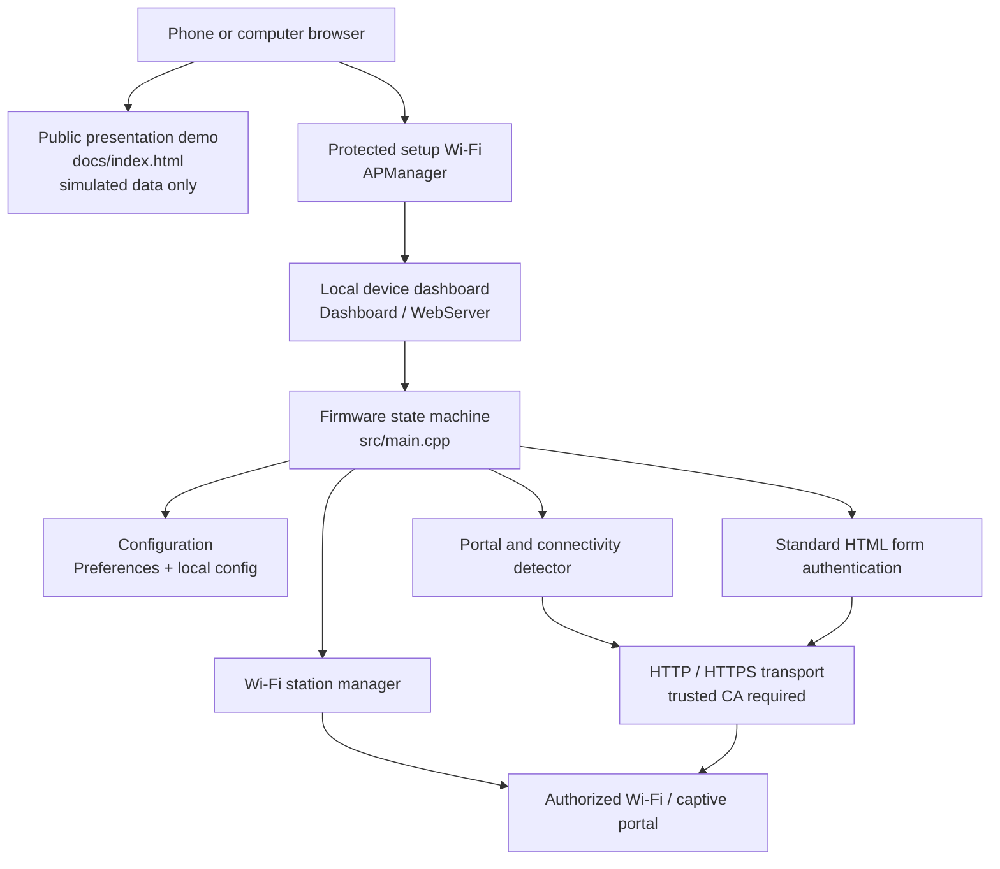

# SetuNet

**A local-first ESP32 captive-portal assistant with a responsive device dashboard and a public presentation demo.**

SetuNet connects an ESP32 to an authorized Wi-Fi network, detects common captive-portal behavior, submits supported HTTPS login forms, and monitors connectivity. A password-protected setup network lets you configure and inspect the device from a phone or computer.

| | |
|---|---|
| **Presentation demo** | [mradul-consultancy.github.io/SetuNet](https://mradul-consultancy.github.io/SetuNet/) |
| **Source repository** | [github.com/Mradul-Consultancy/SetuNet](https://github.com/Mradul-Consultancy/SetuNet) |
| **Target** | ESP32 Dev Module (`esp32dev`) |
| **Framework** | Arduino via PlatformIO |
| **Project status** | Prototype; firmware builds, but live portal and hardware behavior still need field validation |

> **Demo data is simulated.** The public site is for presentations and does not connect to an ESP32. Live device status is available only from the dashboard hosted by the physical device on its local setup network.

## Highlights

- Joins a configured Wi-Fi network in ESP32 station mode.
- Hosts a separate WPA2-protected setup access point and local web dashboard.
- Shows Wi-Fi, internet/authentication, signal, uptime, and login-attempt status.
- Saves supported configuration to ESP32 Preferences and offers a connection retry action.
- Detects common captive portal redirects and parses standard HTML forms, including hidden fields.
- Sends portal credentials only through HTTPS POST with trusted CA verification; refuses insecure HTTP/GET login submissions.
- Monitors connectivity and retries portal authentication after failures.
- Includes a public presentation dashboard with visibly labeled simulated data.

## Try the public demo

Open **[the SetuNet presentation demo](https://mradul-consultancy.github.io/SetuNet/)**. It starts in Demo mode and shows illustrative network and authentication values. Choose **Real device** to see the instructions for using the ESP32-hosted dashboard.

The public site cannot reach the device’s private `192.168.4.1` address. Demo values are not telemetry, test results, or proof of a successful portal login.

## Hardware dashboard

After uploading the firmware:

1. Open the PlatformIO serial monitor at `115200` baud.
2. Join the `SetuNet-Setup-XXXX` Wi-Fi network reported at boot, using the generated password printed on the serial monitor.
3. Open **http://192.168.4.1** in a browser.
4. Review the connection status, configure network/portal settings if needed, or request a retry.

The setup access point remains available while the ESP32 attempts to connect to the configured Wi-Fi. A saved settings change restarts the device. Passwords are never prefilled into the dashboard; leave a password field empty to retain its saved value. Use the explicit open-network option only for an unprotected Wi-Fi network.

## Build and upload

### Requirements

- ESP32 Dev Module or a compatible ESP32 board
- USB data cable and the correct USB-to-serial driver
- [PlatformIO Core](https://platformio.org/install/cli) or the PlatformIO extension for VS Code
- Access to a Wi-Fi network and portal account you are authorized to use

### Configure local credentials

From the project root, copy the templates:

```text
include/config.h.template   → include/config.h
include/portal_ca.h.template → include/portal_ca.h
```

Set your local values in `include/config.h`:

```cpp
#define WIFI_SSID "your-network-name"
#define WIFI_PASSWORD "your-wifi-password"
#define PORTAL_URL "https://your-actual-login-page/"
#define PORTAL_USER "your-authorized-portal-username"
#define PORTAL_PASS "your-portal-password"
```

The local `include/config.h` and `include/portal_ca.h` are Git-ignored. Do not commit real credentials or certificates copied from an untrusted connection. Values compiled from `config.h` are embedded in the firmware image; the dashboard can also save settings to Preferences.

If the portal uses non-standard form input names, set:

```cpp
#define PORTAL_USERNAME_FIELD "username-input-name"
#define PORTAL_PASSWORD_FIELD "password-input-name"
```

Leave them empty to use field inference.

### Configure HTTPS trust

HTTPS login fails closed unless `include/portal_ca.h` contains the appropriate trusted CA certificate and the device clock is valid. Add the trusted PEM certificate in the template’s provided C++ raw string literal. Obtain the trust anchor from the network administrator or another trusted source. SetuNet attempts NTP synchronization after Wi-Fi connection; if the network prevents time synchronization before login, use an authorized time source or RTC rather than disabling TLS verification.

### Compile, flash, and monitor

```sh
pio run -e esp32dev
pio run -e esp32dev --target upload
pio device monitor -b 115200
```

Change the board and upload settings in `platformio.ini` if you use another supported ESP32 board.

## Architecture



The firmware starts its protected setup access point and dashboard, loads settings from Preferences or compile-time defaults, connects as a Wi-Fi station, detects portal behavior, and attempts a supported login when needed. The connectivity monitor periodically checks access and triggers recovery behavior.

## Repository layout

```text
.
├── docs/
│   ├── index.html          Public static presentation demo
│   ├── .nojekyll           Prevents Jekyll parsing unrelated research documents
│   └── ...                 Architecture and supporting documentation
├── include/                Firmware interfaces and configuration templates
├── scripts/                Build, flash, monitor, and test helper scripts
├── src/                    Firmware implementation and application state machine
├── test/                   PlatformIO Unity tests (execute on ESP32 hardware)
├── platformio.ini          ESP32 build and test environments
├── GETTING_STARTED.md      Hardware setup and validation guide
└── README.md               Project overview
```

## Validation and limitations

The `esp32dev` firmware build has been verified with PlatformIO. This confirms compilation only; it does not establish that the device works with a particular board, Wi-Fi network, or live captive portal. The public GitHub Pages presentation demo has been deployed and browser-checked.

Portal flows differ and may change. The current form parser is not a browser engine and does not support:

- JavaScript-driven challenges or multi-step login flows
- Every CSRF, cookie, redirect, or form-control pattern
- Guaranteed independent portal-session-expiry detection
- Arbitrary portal APIs

Router, NAT, and DNS forwarding are **not integrated** into the running application. The integrated setup AP is for configuration and local dashboard access, not internet sharing. Live GLA portal testing, physical-board upload, recovery testing, and extended soak testing remain to be completed.

The Unity test firmware requires an ESP32 and serial connection to execute:

```sh
pio test -e esp32dev_test
```

## Security

- Use only networks and accounts you are authorized to access.
- Portal credentials are sent only over HTTPS POST; the firmware does not bypass certificate verification.
- Configure a trusted portal CA and valid clock before relying on HTTPS login.
- The setup Wi-Fi password is generated at boot and printed to serial. Restrict physical and serial access.
- The local dashboard uses HTTP over the protected setup network. Wi-Fi protection and a per-boot request token do **not** provide end-to-end encryption; do not use it on an untrusted setup network.
- ESP32 Preferences/NVS is not encrypted by this application. Configure hardware flash/NVS encryption separately if required.
- Never publish `config.h`, portal CA material, account passwords, session cookies, or real network credentials.

## Documentation

- [Getting started](GETTING_STARTED.md)
- [Architecture](docs/ARCHITECTURE.md)
- [API reference draft](docs/API_REFERENCE.md)
- [User guide draft](docs/USER_GUIDE.md)
- [Presentation demo](https://mradul-consultancy.github.io/SetuNet/)

Some documents under `docs/` are historical research or design drafts. Treat their proposed features, measurements, and claims as unverified unless accompanied by reproducible test evidence.
